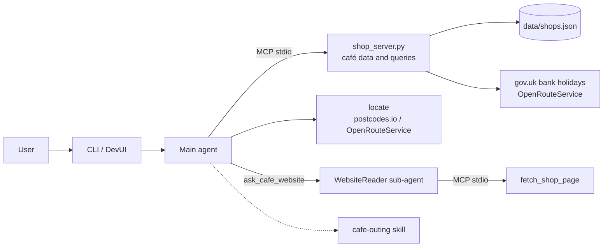

# Coffee Shop Finder Agent

A personal coffee shop assistant built with [Microsoft Agent Framework](https://github.com/microsoft/agent-framework) (Python). It answers practical questions about a small set of cafés you visit: which is open, which is nearest, where a drink is cheapest, what's on their menu, and where to go right now.

It is deliberately small, and built to show agentic patterns working together: tool calling, a custom MCP server, context providers, middleware, web retrieval with prompt-injection containment, Agent Skills, a sub-agent, a browser UI and local evaluation.

## Features

- **Opening hours** for now, a given day, or a specific date, with bank-holiday notes for England and Wales.
- **Nearest café** by real walking time from a postcode or place name.
- **Price comparison** for any drink, tolerant of typos.
- **Live website reading** through a sandboxed sub-agent, so untrusted page text never reaches the main agent.
- **Café outing planner** as an Agent Skill: combines location, opening hours, walking time and price into one recommendation.
- **CLI and browser UI** (DevUI), plus a local evaluation suite.

## Architecture



| Component | Role |
|---|---|
| `agent.py` | Main agent: model client, instructions, context providers (clock, chat history, skills), middleware and the CLI loop. |
| `shop_server.py` | FastMCP server that owns the café data and every query over it: `list_shops`, `get_shop`, `open_shops`, `compare_prices`, `nearest_shops`, `fetch_shop_page`. |
| `tools/geo.py` | Local `locate` tool: turns a postcode or place name into coordinates. |
| WebsiteReader | Sub-agent exposed to the main agent as `ask_cafe_website` (via `as_tool()`). Its only tools are `list_shops` and `fetch_shop_page`, and it keeps no history. |
| `skills/cafe-outing/` | File-based Agent Skill, loaded on demand through `SkillsProvider`. |
| Middleware | Tool-call tracing, bank-holiday notes added to answers in code, skill-name repair, and a cap of 12 tool calls per turn. |

**Design rule:** the MCP server owns everything about the cafés, even when that needs an external API. Local tools only handle the user's side, such as their location.

## Getting started

### Prerequisites

- Python 3.12
- A model behind an OpenAI-compatible endpoint, Azure OpenAI, or Microsoft Foundry
- Optional: a free [OpenRouteService](https://openrouteservice.org/) API key for walking routes and place-name search. Without it, walking times are straight-line estimates and only postcodes can be looked up.

### Install

```bash
git clone https://github.com/oakker-myo/coffee-shop-finder-agent.git
cd coffee-shop-finder-agent
python -m venv .venv
.venv\Scripts\activate        # Windows; use `source .venv/bin/activate` on macOS/Linux
python -m pip install -r requirements.txt
```

### Configure

Copy `.env.sample` to `.env` and fill in the values for your provider:

| Variable | Description |
|---|---|
| `PROVIDER` | `openai` (any OpenAI-compatible endpoint), `azure_openai` or `foundry` |
| `OPENAI_BASE_URL`, `OPENAI_API_KEY`, `OPENAI_MODEL` | For `openai`. Leave the base URL empty for api.openai.com. |
| `AZURE_OPENAI_ENDPOINT`, `AZURE_OPENAI_API_KEY`, `AZURE_OPENAI_MODEL` | For `azure_openai` |
| `FOUNDRY_PROJECT_ENDPOINT`, `FOUNDRY_MODEL` | For `foundry` (signs in with `DefaultAzureCredential`) |
| `REASONING_EFFORT` | Optional, passed to the model, e.g. `none` or `low` |
| `TIMEZONE` | Default `Europe/London` |
| `ENV` | `dev` logs every tool call to the console |
| `ORS_API_KEY` | Optional OpenRouteService key |
| `GEOCODE_FOCUS` | Optional `lat,lng` that place-name searches are limited to (within 20 km) |

Then add your cafés. Copy `data/shops.sample.json` to `data/shops.json` and edit it. Each café has an id, name, address, postcode, coordinates, website (and optional menu URL), weekly hours, drink prices, rating, your own rank and your notes. `data/shops.json` is gitignored.

### Run

```bash
python agent.py     # chat in the terminal
python devui.py     # browser UI at http://127.0.0.1:8080, showing each tool call
```

Example questions:

- *Which café is open now?*
- *Is Sample Roasters open on Christmas Day?*
- *Which café is nearest to WC2N 5DN?*
- *Where's the cheapest flat white?*
- *What food does Sample Roasters serve?*
- *Where should I go for a latte near WC2N 5DN tomorrow?*

> **Model choice:** the tools work with small local models, but the `cafe-outing` skill needs a capable model. With a 4B local model (`qwen3.5:4b`) the agent loads the skill but skips steps.

## Evaluation

`evaluate.py` runs a set of questions through the agent and checks each one locally with the framework's `evaluate_agent` and `LocalEvaluator`:

- the expected tools were called, with the expected arguments;
- the answer contains an expected phrase;
- a report shows each question's result, the tools called and the full answer.

```bash
cp eval/cases.sample.json eval/cases.json   # edit for your own cafés; eval/cases.json is gitignored
python evaluate.py
```

The sample cases target the cafés in `data/shops.sample.json`.

## Safety notes

- **Web fetch only reaches café URLs stored in `shops.json`.** The model can't type a URL. Fetches have a timeout, a 1 MB size cap, a content-type check and same-site redirects only.
- **Page text is cleaned before any model sees it:** scripts, styles and hidden elements are removed, it's capped at 4,000 characters and wrapped in "untrusted" markers. Only the WebsiteReader sub-agent sees it.
- **No tool changes anything,** so a successful prompt injection can at worst produce a wrong answer, never a data leak or an action.
- **DevUI** binds to `127.0.0.1` only, with authentication turned off. Don't expose it to a network.

## Project structure

```text
.
├── agent.py                 # main agent, middleware, CLI
├── shop_server.py           # MCP server: café data and queries
├── tools/geo.py             # locate tool
├── skills/cafe-outing/      # Agent Skill: SKILL.md + references/
├── devui.py                 # browser UI
├── evaluate.py              # local evaluation
├── eval/cases.sample.json   # sample evaluation cases
├── data/shops.sample.json   # sample café data
├── config.py                # settings from .env
└── requirements.txt
```

## Potential Improvements/Future Work

- **API, deployment and observability:** an HTTP API, deployment to Azure, and monitoring with OpenTelemetry traces.
- **Broader evaluation:** more cases, quality metrics (such as similarity and groundedness), run metrics (token usage, tool results), and results written to a file.
- **Persistent memory:** conversations that survive a restart.

## Built with

- [Microsoft Agent Framework](https://github.com/microsoft/agent-framework) 1.19
- [Model Context Protocol](https://modelcontextprotocol.io/) Python SDK (FastMCP)
- [postcodes.io](https://postcodes.io/), [OpenRouteService](https://openrouteservice.org/), [GOV.UK bank holidays](https://www.gov.uk/bank-holidays.json)
